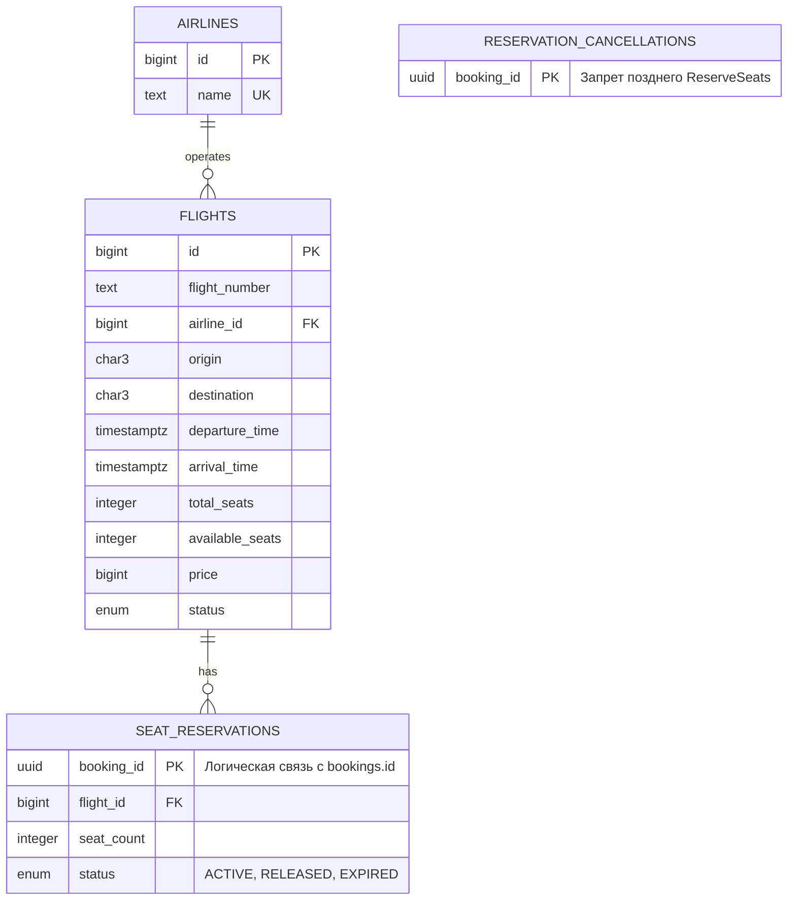
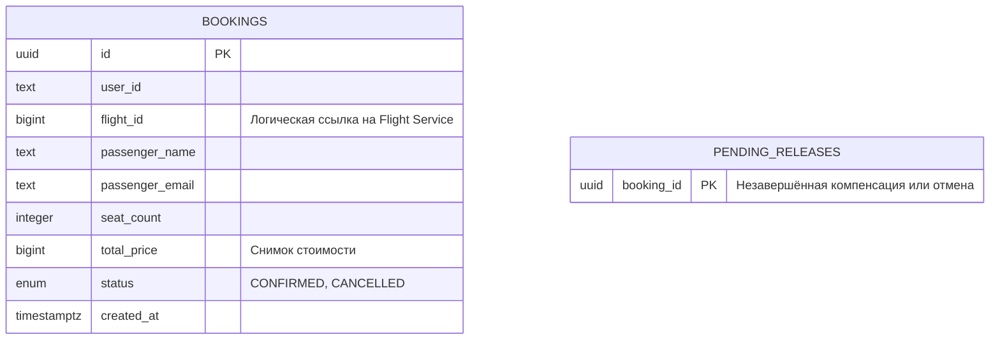

# ER-диаграмма

Flight Service — отдельная PostgreSQL:

Booking Service — другая PostgreSQL:

Связь `bookings.id → seat_reservations.booking_id` — логическая 1:1 для успешного бронирования. Между базами нет внешних ключей и прямых запросов. Служебный `pending_releases` намеренно не имеет FK: компенсация нужна и тогда, когда бронирование не было создано.

3NF: атрибуты каждой таблицы зависят от её ключа; название авиакомпании вынесено в `airlines`. Аэропорт представлен только IATA-кодом, отдельной сущности с дополнительными атрибутами нет. Данные пользователя и пассажира не смешиваются: имя и email — данные конкретного бронирования. `total_price` — историческая стоимость, а не производное от текущей цены рейса. `available_seats` хранится по условию задания и изменяется вместе с резервациями в одной транзакции.

В SQL заданы PK, FK, UNIQUE и CHECK: уникальность `(flight_number, дата вылета в UTC)`, разные аэропорты, IATA из трёх заглавных букв, прилёт позже вылета, `total_seats > 0`, `0 <= available_seats <= total_seats`, положительные цена и число мест, допустимые статусы. Статусы в БД ограничены CHECK, в protobuf используются enum. Файлы миграций — в `internal/storage/migrations`; `schema_migrations` хранит применённые версии.
